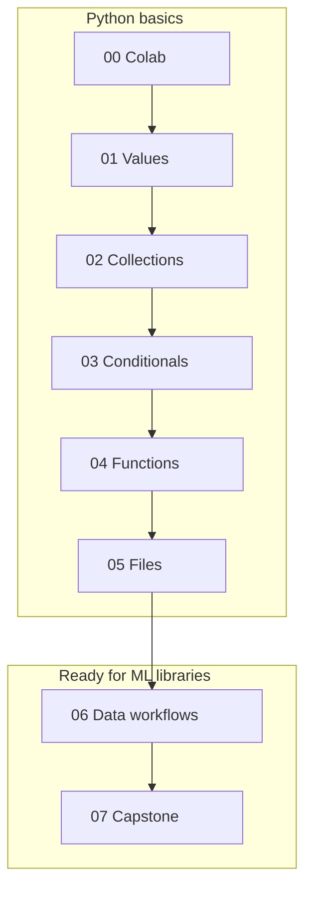
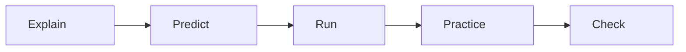
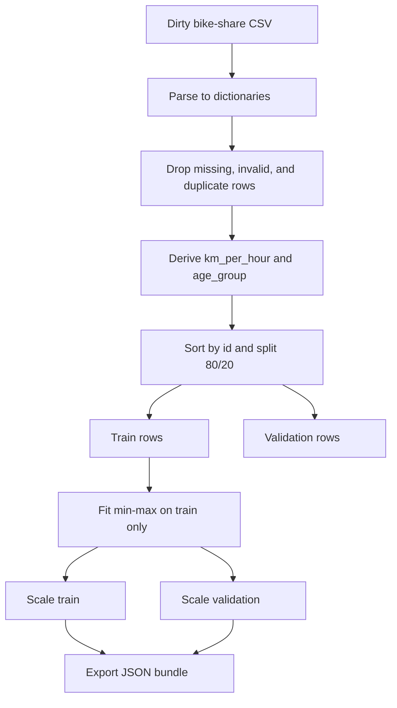
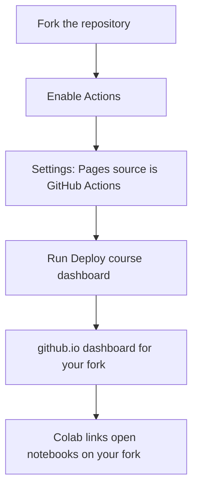
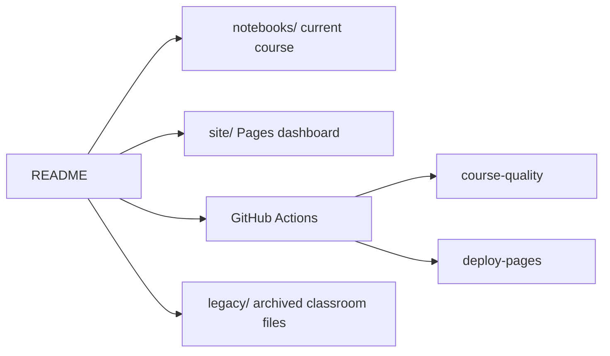

# Python Crash Course

Beginner Python for people who want to be ready for machine learning libraries next — not a NumPy/pandas/scikit-learn course yet.

**Start here:** [notebooks/00_Colab_and_First_Program.ipynb](notebooks/00_Colab_and_First_Program.ipynb) · [Open in Colab](https://colab.research.google.com/github/ialimustufa/python-crash-course/blob/master/notebooks/00_Colab_and_First_Program.ipynb)

**Track progress:** [GitHub Pages dashboard](https://ialimustufa.github.io/python-crash-course/) (self-tracked in your browser)

## Who this is for

- You can use a browser. You do not need Python installed locally.
- You want a stepped path: Colab → values → collections → control flow → functions → files → data preparation.
- After the capstone you should be ready to open a NumPy or pandas tutorial without fighting basic Python.

## How to take the course

1. Work in **Google Colab**. Click a badge, then **File → Save a copy in Drive**.
2. Run each notebook from the top. If the runtime gets confused, **Runtime → Restart session** and **Run all**.
3. Practice cells already contain working answers so the notebook can be verified. To practice, delete the answer, rewrite it, and run the check.
4. Optional: [fork this repository](https://github.com/ialimustufa/python-crash-course/fork) and enable the Pages dashboard so your copy has its own progress page.

There is no `input()` in the maintained notebooks, so they never wait for a prompt.

```mermaid
flowchart LR
  startNode["Open notebook 00&nbsp;&nbsp;&nbsp;&nbsp;&nbsp;&nbsp;&nbsp;&nbsp;"] --> copyDrive["Save a copy in Drive&nbsp;&nbsp;&nbsp;&nbsp;&nbsp;&nbsp;&nbsp;&nbsp;"]
  copyDrive --> runTop["Run cells top to bottom&nbsp;&nbsp;&nbsp;&nbsp;&nbsp;&nbsp;&nbsp;&nbsp;"]
  runTop --> rewrite["Rewrite the practice cells&nbsp;&nbsp;&nbsp;&nbsp;&nbsp;&nbsp;&nbsp;&nbsp;"]
  rewrite --> nextNb["Open the next notebook&nbsp;&nbsp;&nbsp;&nbsp;&nbsp;&nbsp;&nbsp;&nbsp;"]
  nextNb --> optionalDash["Optional: tick progress on Pages&nbsp;&nbsp;&nbsp;&nbsp;&nbsp;&nbsp;&nbsp;&nbsp;"]
```

## Course path

| # | Notebook | Time | What you learn | Colab |
|---|---|---|---|---|
| 00 | [Colab and your first program](notebooks/00_Colab_and_First_Program.ipynb) | 40 min | Runtime, print, variables, `+=`, unpacking, indentation, reading errors | [Open](https://colab.research.google.com/github/ialimustufa/python-crash-course/blob/master/notebooks/00_Colab_and_First_Program.ipynb) |
| 01 | [Values, strings, and conversion](notebooks/01_Values_Strings_and_Conversion.ipynb) | 55 min | Types, `/` `//` `%`, `strip`/`replace`/`join`, `is None`, converting CSV-like strings, f-strings | [Open](https://colab.research.google.com/github/ialimustufa/python-crash-course/blob/master/notebooks/01_Values_Strings_and_Conversion.ipynb) |
| 02 | [Collections, indexing, and slicing](notebooks/02_Collections_Indexing_and_Slicing.ipynb) | 60 min | Lists, tuples, dicts, sets, `in` on keys, `.get`/`.items()`, `sorted` vs `.sort()`, copies | [Open](https://colab.research.google.com/github/ialimustufa/python-crash-course/blob/master/notebooks/02_Collections_Indexing_and_Slicing.ipynb) |
| 03 | [Conditionals and loops](notebooks/03_Conditionals_and_Loops.ipynb) | 60 min | `if`/`elif`, loops, dict counts, `any`/`all`, missing vs `0` | [Open](https://colab.research.google.com/github/ialimustufa/python-crash-course/blob/master/notebooks/03_Conditionals_and_Loops.ipynb) |
| 04 | [Functions, scope, and comprehensions](notebooks/04_Functions_Scope_and_Comprehensions.ipynb) | 55 min | `def`, returns, docstrings/`help`, copy-not-mutate, list/dict comprehensions | [Open](https://colab.research.google.com/github/ialimustufa/python-crash-course/blob/master/notebooks/04_Functions_Scope_and_Comprehensions.ipynb) |
| 05 | [Errors, modules, and files](notebooks/05_Errors_Modules_and_Files.ipynb) | 60 min | Errors, `pathlib`, JSON, CSV, `datetime`, `NaN` / `isclose` | [Open](https://colab.research.google.com/github/ialimustufa/python-crash-course/blob/master/notebooks/05_Errors_Modules_and_Files.ipynb) |
| 06 | [Python data workflows for ML](notebooks/06_Python_Data_Workflows_for_ML.ipynb) | 65 min | Clean rows, codes and one-hot, table shapes, split first, train-only scaling | [Open](https://colab.research.google.com/github/ialimustufa/python-crash-course/blob/master/notebooks/06_Python_Data_Workflows_for_ML.ipynb) |
| 07 | [Fundamentals capstone](notebooks/07_Fundamentals_Capstone.ipynb) | 60 min | Prepare a dirty bike-share CSV end to end — no model yet | [Open](https://colab.research.google.com/github/ialimustufa/python-crash-course/blob/master/notebooks/07_Fundamentals_Capstone.ipynb) |

About seven to eight hours if you do the practices instead of only reading.

## Exercises, hints, and solutions

Each notebook repeats a short cycle: explain → predict → run → practice → check.

Concept sections in each notebook include Mermaid diagrams of the idea (runtime, types, aliases, splits, and so on). They show as pictures in Colab and as Mermaid on GitHub.

- **Predict** questions ask you to decide the output before you run. Answers sit under *After you run*.
- Practice cells include a working answer so **Run all** never fails. Comment it out, rewrite it, then run the check.
- Checks are `assert` statements that print `Practice xx.y passed.`
- Hints sit under each practice. Solutions and a short *Check your understanding* section are at the end.

## Capstone

Notebook 07 prepares a dirty bike-share CSV in **pure Python**: parse, type, drop missing/invalid/duplicate rows, derive features, split 80/20 by id, min-max scale using training rows only, then export a JSON bundle. You do **not** train a model.

You are done when every capstone check prints `passed`.

## Fork this course and enable the dashboard

Progress is **self-tracked** in `localStorage`. GitHub Actions does not grade your Colab work. The quality workflow only checks that the maintained notebooks still run.

On your fork:

1. Enable **Actions** if GitHub asks (the first Actions tab visit).
2. Open **Settings → Pages**.
3. Set **Source** to **GitHub Actions**. This has to exist before the deploy workflow can publish; the first run fails with `Get Pages site failed` until it is on.
4. Run **Deploy course dashboard** from the Actions tab, or push a change under `site/`.
5. Open `https://<your-username>.github.io/python-crash-course/`.

The dashboard writes Colab links for **your** owner/repo/branch. Export JSON if you switch browsers. Reset stays on that device.

## What to learn next

After this course:

- NumPy arrays
- pandas DataFrames
- a plotting library (Matplotlib or Seaborn)
- scikit-learn `Pipeline` and `train_test_split`

The verbs stay the same: clean, split, scale, check.

## How this repository is organized

Maintained materials are `notebooks/` and `site/`. CI executes only the numbered notebooks. Historical files stay in `legacy/` and are not part of the path above.

## Legacy classroom archive

Older live-session notebooks and scripts live in [`legacy/`](legacy/). They are unmaintained and are not part of the numbered path. Several of them do not run top-to-bottom; that is expected.

## Author

Ali Mustufa — [iali.dev](http://iali.dev) · [@ialimustufa](http://twitter.com/ialimustufa)
