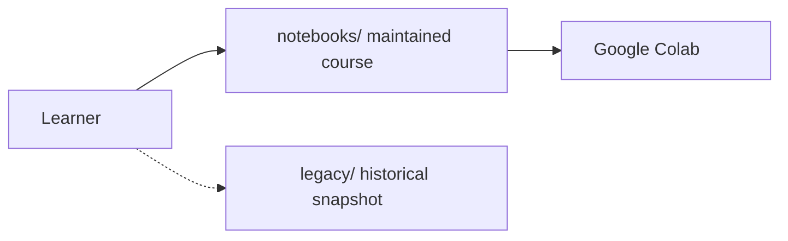

# Legacy classroom archive

This folder is **unmaintained archived classroom material** from earlier live sessions. It is kept for historical reference only. Filenames and content are preserved as they were; examples that never ran cleanly are left that way on purpose.

**Learn here instead:** the current course lives at the repository root and in [`notebooks/`](../notebooks/). Use those notebooks (and the course README) rather than this archive.

## What is here

- [`notebooks/`](notebooks/) — four original Colab / Jupyter notebooks
- [`examples/`](examples/) — standalone `.py` classroom scripts

## Known clean-run limitations

Do not expect “Restart session and run all” (or `python script.py`) to succeed. Typical issues include:

- **IndentationError cells** in `Introduction_to_Python.ipynb` and `Python_for_Machine_Learning.ipynb` (intentional `if` / indent demos that fail as written).
- **Stale saved outputs**, including stored error traces (`IndentationError`, `TypeError` on tuple assignment in `Python Crash Course.ipynb`).
- **Broken or unfinished TODOs** — starter cells such as `#TO-DO Print Hello World`, string/list/dict exercises, `# TO-DO Convert my_age to int`, even/odd lambda work, and the incomplete diamond-shape prompt in `Python_Loops.ipynb`.
- **`input()`-heavy notebooks and scripts** that block in non-interactive runs (`my_age = input(...)`, student records, list input, marks, typecasting, and similar).
- **Syntax and classroom-draft errors** in scripts (for example `typecasting.py` cannot parse as written).
- **Homework left as prompts** (data-collection HW in `Introduction_to_Python.ipynb`) rather than complete programs.

Open these files only if you want the original classroom snapshot. For a maintained path that is meant to run top-to-bottom, use the new course.
